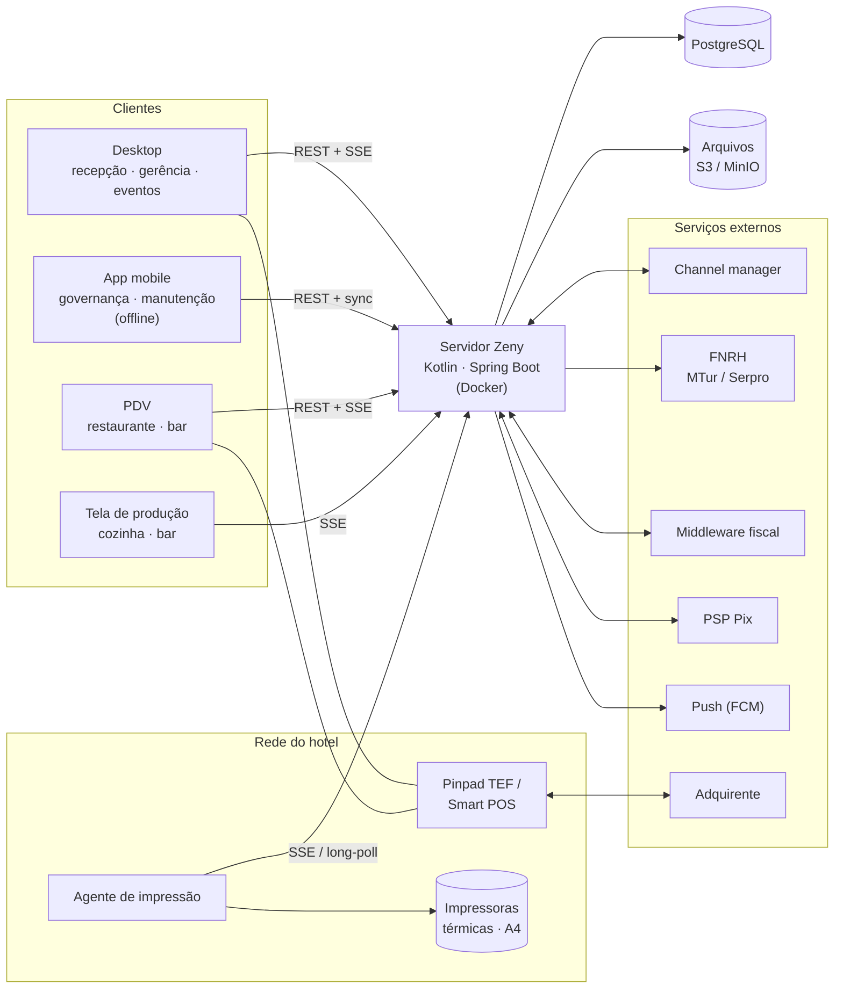
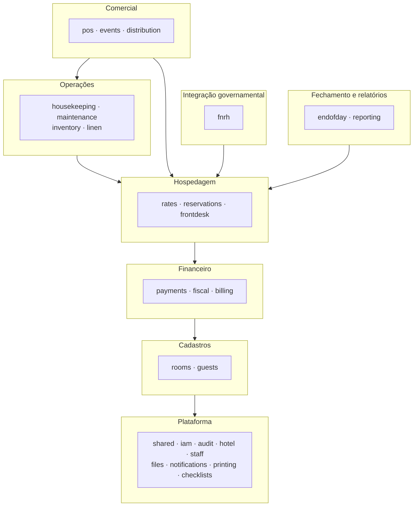
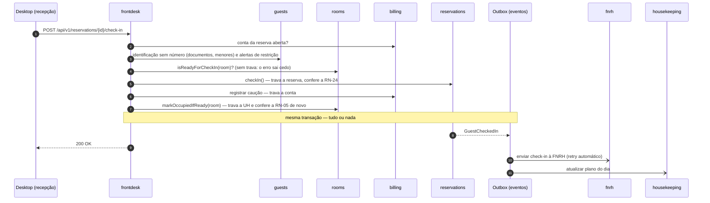
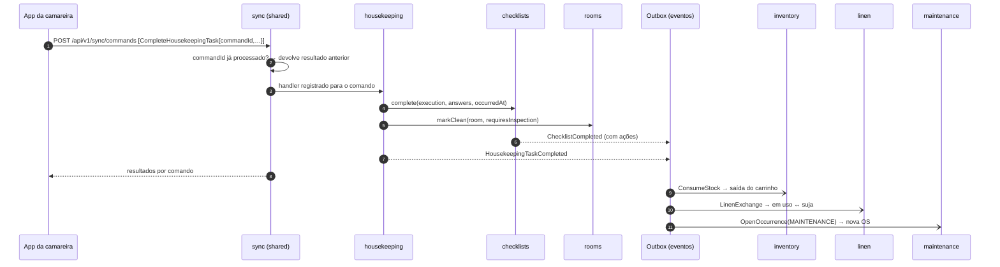
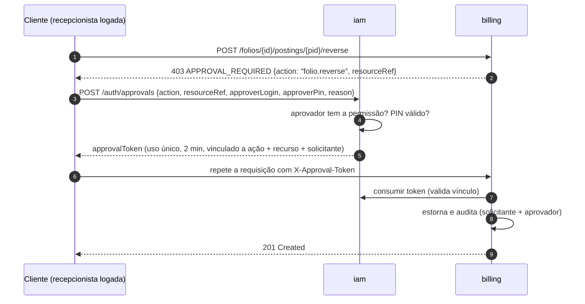
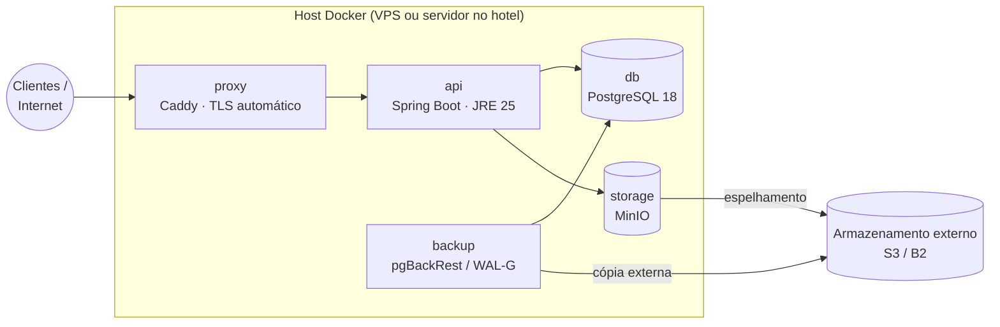

# ARCHITECTURE — Zeny Hotel Manager (servidor)

> Arquitetura do servidor · versão 0.1 (rascunho para revisão) · 2026-10-09
>
> O **o quê** está em [SPEC.md](SPEC.md). Este documento trata do **como**.

---

## 1. Visão geral

Este repositório contém **somente o servidor**: uma aplicação Kotlin/Spring Boot empacotada como imagem Docker. Ela expõe:

- uma **API REST** versionada, cujo contrato OpenAPI é publicado como artefato;
- um canal de **tempo real** (Server-Sent Events);
- um protocolo de **sincronização offline** para o app operacional.

Os clientes ficam em repositórios próprios e geram seus SDKs a partir do contrato OpenAPI:

- desktop: recepção, gerência e eventos;
- mobile: governança e manutenção;
- PDV: restaurante e bar;
- tela de produção: cozinha e bar;
- agente de impressão.



---

## 2. Decisões arquiteturais

| # | Tema | Decisão | Motivo | Alternativas descartadas |
|---|---|---|---|---|
| D1 | Estilo | **Monólito modular** com Spring Modulith. Há um único deployável e cada módulo corresponde a um contexto do SPEC. Os limites entre módulos são verificados em teste. | Um único hotel e equipe pequena: um processo, um banco e transações locais. Os limites explícitos permitem extrair um serviço no futuro, se fizer sentido. | Microsserviços (custo operacional desproporcional); monólito sem limites (vira acoplamento) |
| D2 | Linguagem | **Kotlin 2.x** sobre **JDK 25 LTS** | Null-safety, `data`/`sealed`/`value` classes para um domínio rico, decidido na entrevista | Java 21+ |
| D3 | Framework | **Spring Boot 4.x**, Spring Security, Spring Data JPA e Spring Modulith 2.x | Ecossistema maduro para domínio transacional; o Modulith dá eventos com outbox e verificação de módulos | Ktor, Quarkus |
| D4 | Banco | **PostgreSQL 18**, com **um schema por módulo** | Transações ACID, `EXCLUDE` com `daterange` para evitar UH em dobro, JSONB para payloads e logs | MySQL |
| D5 | Persistência | **JPA/Hibernate** para agregados e **SQL via `JdbcClient`** para consultas e relatórios. Migrações com **Flyway**. | O JPA cobre bem o lado de escrita. Leituras complexas ficam em SQL explícito. | jOOQ (opção futura se o JPA incomodar), Exposed |
| D6 | API | REST/JSON em `/api/v1`, **code-first** com springdoc. O `api/openapi.yaml` é gerado no build e **versionado no repositório**. A CI barra mudanças incompatíveis. | Um único desenvolvedor do servidor. O contrato publicado continua sendo a fonte da verdade para os clientes. | Contract-first com geração de stubs (atrito em Kotlin); GraphQL |
| D7 | Autenticação | Usuários locais. **JWT de acesso curto (15 min)** e **refresh token opaco e rotativo por dispositivo**, com revogação. | Atende celulares pessoais e desligamentos imediatos sem depender de um IdP externo | Keycloak/IdP externo (opção futura via OIDC) |
| D8 | Autorização | Catálogo de permissões **em código**, roles no banco, **escopo** aplicado nas consultas, **limites** checados no domínio e **step-up** por PIN | Requisito da entrevista (SPEC §5.1) | RBAC fixo por enum de roles |
| D9 | Comunicação entre módulos | Chamadas síncronas à **API pública** do módulo para consultas e comandos. **Eventos de domínio** com o *Event Publication Registry* (outbox transacional) para efeitos colaterais. | Consistência forte onde é preciso (check-in) e desacoplamento com garantia de entrega no resto | Broker externo (Kafka/RabbitMQ), desnecessário em processo único |
| D10 | Tempo real | **SSE** por tópico, com reconexão via `Last-Event-ID` | Comunicação só servidor→cliente; mais simples que WebSocket e passa por proxies | WebSocket/STOMP |
| D11 | Offline | **Comandos idempotentes** (UUIDv7 gerado no cliente) e **pull incremental por cursor**. O servidor tem a palavra final. | Requisito do app operacional. Tarefas e checklists são majoritariamente *append-only*, então há poucos conflitos. | CRDT/replicação de banco |
| D12 | Integrações | **Portas e adaptadores** por provedor, com outbox, retry, backoff e idempotência. Modos **push e pull**. | Fornecedores ainda não definidos e servidor que pode ser local, sem portas abertas | Integração direta no código de domínio |
| D13 | Impressão | **Agente de impressão** na LAN que abre a conexão até o servidor (só saída) e recebe jobs | Funciona com o servidor na nuvem ou no local | Servidor imprimindo direto (só funciona on-prem) |
| D14 | Arquivos | Armazenamento **compatível com S3** (MinIO no compose; S3/R2 na nuvem), atrás de uma interface | Uma API para os dois ambientes, com URLs assinadas | Disco local, que complica backup e escala |
| D15 | Identificadores | **UUIDv7** gerados na aplicação, com números legíveis por sequência (`R-2026-000123`) | Permite gerar IDs offline no cliente, é ordenável e se indexa bem | Autoincremento |
| D16 | Tempo e dinheiro | `timestamptz` em UTC, `date` para datas de negócio, fuso do hotel na configuração. `Money` sobre `BigDecimal`/`numeric(14,2)`. | RN-01 e RN-02 | `double`, horário local no banco |
| D17 | Idioma do código | Código, API e banco em **inglês**; termos de domínio mapeados no glossário do SPEC | Convenção do ecossistema; evita acentos em identificadores | Português no código |

---

## 3. Módulos

### 3.1 Mapa de módulos

| Módulo (pacote) | SPEC | Responsabilidade | Depende de |
|---|---|---|---|
| `shared` | — | Kernel compartilhado: `Money`, `Percent`, IDs, `Address`, CPF/CNPJ, erros, contexto de segurança, infraestrutura de sync, idempotência e SSE | — |
| `iam` | ACS | Usuários, roles, catálogo de permissões, sessões e aprovações | shared |
| `audit` | ACS | Trilha de auditoria *append-only* | shared |
| `hotel` | CFG | Configuração, políticas, taxas e **data operacional** | shared, files |
| `staff` | PES | Colaboradores, setores, turnos e escala | shared, iam, hotel |
| `files` | — | Anexos (S3), URLs assinadas e cifragem de sensíveis | shared |
| `notifications` | NOT | Notificações internas, preferências e push | shared, iam |
| `printing` | NOT | Agentes, impressoras e fila de impressão | shared, hotel |
| `checklists` | CHK | Modelos, versões, execuções e rotinas | shared, hotel, staff, files |
| `rooms` | UH | Tipos de UH, UHs, áreas, status e OOO/OOS | shared, hotel |
| `guests` | HOS | Hóspedes, empresas, consentimentos e LGPD | shared, files |
| `payments` | PAG | `PaymentIntent`, Pix, cartão, tokens e conciliação | shared, notifications |
| `fiscal` | FIS | Perfis fiscais, documentos e provedor fiscal | shared, hotel, files, notifications |
| `billing` | CTA | Contas, lançamentos, roteamento, caixa, caução e contas a receber | shared, hotel, guests, notifications, payments, fiscal, printing |
| `rates` | TAR | Planos, preços, restrições, pacotes e políticas | shared, hotel, rooms, billing |
| `reservations` | RES | Bookings, reservas, bloqueios, alocação e **disponibilidade** | shared, hotel, rooms, rates, guests, billing, notifications, printing |
| `frontdesk` | REC | Orquestra check-in/out, walk-in, troca de UH, recados e itens de empréstimo | shared, hotel, files, rates (só os tipos públicos da `ReservationsApi`: `RatePlanId`, `GuaranteeType`, `PackageId` e `PackageCharge`; nenhuma chamada à `RatesApi`), reservations, rooms, guests, billing, payments, fiscal, printing |
| `fnrh` | FNRH | Integração com a FNRH | shared, hotel, reservations, guests, notifications |
| `distribution` | DIS | Integração com o channel manager | shared, rooms, rates, reservations, notifications |
| `housekeeping` | GOV | Tarefas, distribuição, inspeção, achados e danos | shared, hotel, rooms, reservations, staff, checklists, billing, notifications |
| `inventory` | EST | Itens, locais, movimentos, fornecedores, compras e inventário | shared, checklists, files, notifications |
| `maintenance` | MAN | OS, ativos e preventivas | shared, hotel, rooms, staff, checklists, inventory, files, notifications |
| `linen` | ROU | Enxoval, lavanderia terceirizada e lavanderia do hóspede | shared, rooms, checklists, inventory, reservations, billing |
| `pos` | PDV | Pontos de venda, cardápio, comandas, produção e fichas técnicas | shared, hotel, staff, billing, payments, fiscal, inventory, reservations, printing |
| `events` | EVT | Espaços, eventos, propostas, contratos e BEO | shared, guests, reservations, billing, payments, pos, checklists, files, printing |
| `endofday` | FEC | Fechamento do dia: etapas, pendências e retomada | shared, hotel, rooms, reservations, billing, payments, reporting, notifications |
| `reporting` | REL | Estatísticas diárias, KPIs, relatórios e arquivo de PDFs do fechamento | shared, files, printing, mais as *views* de leitura publicadas pelos módulos (§11) |

O grafo de dependências é **acíclico**, e o teste `ApplicationModules.verify()` falha se surgir um ciclo.

**Regra por camadas.** A tabela acima registra as dependências conhecidas, mas a regra que vale é a das camadas de §3.2: um módulo pode depender de qualquer módulo de uma **camada inferior** e de qualquer módulo da camada **Plataforma**, desde que o grafo continue acíclico. Uma dependência nova que siga essa regra não precisa de aprovação: basta acrescentá-la à tabela na mesma mudança. Depender de um módulo da mesma camada (fora da Plataforma) ou de uma camada superior exige inversão.

Consequências práticas:

- `files`, `notifications`, `printing` e `hotel` são serviços de plataforma: qualquer módulo de negócio pode chamá-los. Quem gera um aviso (estoque mínimo, falha de integração, pendência do fechamento) chama `notifications`; quem é dono de um documento (ficha, extrato, confirmação, proposta) monta os dados e chama `printing` para renderizar e enfileirar.
- `notifications` e `printing` nunca escutam eventos de módulos de negócio, porque isso criaria dependência para cima.

Quando um módulo de baixo nível precisa reagir a algo de um módulo acima, a dependência é invertida:

- **por evento**: o de cima publica, o de baixo não sabe quem escuta;
- **por porta**: o de baixo define uma interface que o de cima implementa.

Exemplos:

- O fechamento do dia avança a data por meio de `hotel`. A governança escuta `BusinessDateAdvanced`, publicado por `hotel`, em vez de depender de `endofday`.
- `checklists` não conhece estoque, rouparia nem manutenção. Esses módulos escutam `ChecklistCompleted` e tratam as ações que lhes dizem respeito.
- `billing` não conhece reservas. Uma conta referencia seu dono por `FolioOwner(type, id)`.
- `guests` não reescreve referências em outros schemas ao mesclar perfis duplicados: publica `GuestsMerged`, e cada módulo que guarda o id de um hóspede (o primeiro é `reservations`) escuta o evento e reponta as próprias referências do absorvido para o sobrevivente.
- Ao fechar uma comanda, o próprio `pos` chama `fiscal` (NFC-e) e `inventory` (baixa por ficha técnica). `fiscal` e `inventory` estão em camadas inferiores e não escutam `TabClosed`.

### 3.2 Camadas de módulos

Cada seta resume as dependências entre os grupos.



---

## 4. Estrutura do código

Há um único projeto Gradle (Kotlin DSL, com *version catalog*). Cada pacote de primeiro nível abaixo da raiz é um módulo do Modulith. O que fica **na raiz do pacote do módulo** é a API pública: interfaces de serviço, DTOs e eventos. Os subpacotes são internos.

```
.
├── api/
│   └── openapi.yaml                 # contrato publicado (gerado no build, versionado)
├── docker/
│   ├── Dockerfile
│   └── compose.yaml                 # api, db, storage, proxy, backup
├── gradle/libs.versions.toml
├── build.gradle.kts
└── src/
    ├── main/
    │   ├── kotlin/com/zeny/hotel/            # pacote base (confirmado em 2026-10-13)
    │   │   ├── ZenyHotelApplication.kt
    │   │   ├── shared/                        # kernel: money, ids, time, errors, sync, sse, security
    │   │   ├── iam/
    │   │   ├── reservations/
    │   │   │   ├── ReservationsApi.kt         # API pública (interface + DTOs)
    │   │   │   ├── ReservationEvents.kt       # eventos publicados
    │   │   │   ├── domain/                    # agregados, value objects, regras (sem Spring)
    │   │   │   ├── application/               # casos de uso, transações, autorização
    │   │   │   ├── infrastructure/            # JPA, adapters, jobs
    │   │   │   └── web/                       # controllers REST, DTOs de API
    │   │   └── …                              # demais módulos, mesma estrutura
    │   └── resources/
    │       ├── application.yaml
    │       └── db/migration/<módulo>/V2026_10_09_1200__create_reservations.sql
    └── test/
        └── kotlin/com/zeny/hotel/
            ├── ModularityTest.kt              # ApplicationModules.verify() + documentação gerada
            └── …                              # testes por módulo
```

Regras internas de cada módulo, verificadas com ArchUnit:

- `domain` não depende de Spring, JPA nem de `web`/`infrastructure`. As anotações JPA ficam toleradas nas entidades por pragmatismo.
- `web` só fala com `application`.
- Outros módulos só usam o que está na raiz do pacote.

---

## 5. Fluxo de uma requisição

1. **`web`**: o controller valida o formato do DTO, converte para comando e chama o caso de uso.
2. **`application`**: o caso de uso abre a transação, aplica **autorização** (permissão, escopo e aprovação), carrega o agregado, executa e persiste.
3. **`domain`**: o agregado aplica as regras de negócio, incluindo limites (ex.: desconto ≤ limite) e transições de estado, e registra **eventos de domínio**.
4. **Commit**: na mesma transação, os eventos são gravados no *Event Publication Registry*, a tabela de outbox do Modulith.
5. **Pós-commit**: os listeners (`@ApplicationModuleListener`) rodam de forma assíncrona e em transação própria. O que falhar fica pendente e é reprocessado com backoff exponencial (1 min dobrando até 1 h); a que ainda falha 24 h depois da publicação é abandonada (fica na tabela, sai do reenvio automático, gera alerta e é reenviada à mão). As concluídas são apagadas depois de 7 dias.
6. A **auditoria** é gravada na mesma transação do caso de uso, via aspecto `@Audited(action)` que captura antes e depois: o caso de uso descreve as entidades que muda pela porta `AuditContext` (o retrato de antes é lido ao acompanhar a entidade e o de depois no fim do método), e o aspecto, que roda dentro da transação, entrega as entradas à porta `AuditTrail` do `shared`, implementada por `audit`. Rollback não deixa entrada, e uma falha ao gravar a entrada desfaz a escrita. Todo caso de uso de escrita leva a anotação (regra ArchUnit).
7. O broadcaster **SSE** recebe os eventos relevantes depois do commit e notifica os clientes inscritos.

Concorrência: os agregados têm `version` para lock otimista, que a API expõe como `ETag`/`If-Match`. Pontos de disputa usam lock pessimista curto, como os contadores de disponibilidade por tipo/data (§11).

---

## 6. Comunicação entre módulos — exemplos

### 6.1 Check-in (orquestração síncrona e efeitos assíncronos)



Ordem real (M5 E02): as conferências sem escrita vêm antes (conta aberta, hóspedes pela `GuestsApi.identification`, que não decifra nada, anexo da comprovação do menor, UH alocada e pronta) e as escritas depois, sempre com as travas na ordem **reserva → conta → UH**. A transição da reserva vem **antes** da caução porque o cancelamento trava a reserva e depois a conta (para lançar a multa): com a caução primeiro, um check-in e um cancelamento simultâneos da mesma reserva travariam em ordem oposta (deadlock). A UH é ocupada por último, e a RN-05 é conferida de novo **com a linha da UH travada** (`RoomsApi.markOccupiedIfReady`): dois check-ins simultâneos na mesma UH (um day use e um pernoite alocados nela, que não conflitam nos meios-dias) se enfileiram na trava, e o segundo encontra a UH ocupada e é recusado (`409 ROOM_NOT_READY`), com a própria transação inteira desfeita.

### 6.2 Checklist concluído offline



### 6.3 Aprovação de superior (step-up)



---

## 7. API

| Tema | Convenção |
|---|---|
| Base e versão | `/api/v1`. Mudança incompatível vai para `/api/v2`. Endpoints descontinuados recebem os headers `Deprecation`/`Sunset`. |
| Recursos | Inglês, plural, kebab-case: `/reservations`, `/housekeeping-tasks`. Transições de estado como subrecurso de ação: `POST /reservations/{id}/check-in`. |
| Contrato | Gerado com springdoc no build em `api/openapi.yaml` e versionado. A CI regenera e falha se houver diff não commitado. O `oasdiff` bloqueia *breaking changes* em `v1`. A exceção é remover um endpoint que já estava marcado como `deprecated` no contrato anterior (e, se ele tiver `x-sunset`, só depois dessa data): primeiro se deprecia, depois se remove. |
| Erros | RFC 9457 (`application/problem+json`) com `code` estável (`ROOM_NOT_READY`, `APPROVAL_REQUIRED`, `LIMIT_EXCEEDED`), `detail` e `errors[]` por campo |
| Idempotência | Header `Idempotency-Key` obrigatório em POSTs com efeito financeiro ou externo (pagamentos, lançamentos, emissão fiscal). A resposta fica guardada por 24h. |
| Concorrência | `ETag` com a versão do agregado; `If-Match` nas alterações; `412` em conflito |
| Paginação | Por cursor: `?cursor=…&limit=…` |
| Enums de resposta que crescem | Decisão do usuário em 2026-10-19 (M3 E05): uma propriedade de resposta cujo conjunto de valores vai crescer (tipos de lançamento, origens, situações que ganham valores a cada marco) sai no contrato como `string` com a lista em `x-extensible-enum`, não como `enum`, porque acrescentar um valor a um `enum` de resposta é *breaking change* (o `oasdiff` o barra: um cliente gerado do contrato anterior falharia no valor novo). Declara-se marcando a propriedade do DTO com `@field:ExtensibleEnum` (`shared`); a lista é gerada das constantes do `enum` Kotlin. O cliente **precisa tolerar valores desconhecidos** (tratá-los como "outro", sem falhar). Um `enum` fechado e estável (dias da semana, `OPEN`/`CLOSED`) continua `enum`; trocar um `enum` já publicado para `x-extensible-enum` muda o tipo gerado nos clientes e precisa de decisão registrada. Primeiro uso: `type` do lançamento (`PostingResponse`). |
| Datas e valores | ISO-8601. Instantes em UTC (`Z`), datas de negócio como `YYYY-MM-DD`. Dinheiro como string decimal (`"123.45"`), sempre em BRL. |
| Documentação | Swagger UI só fora de produção |

---

## 8. Segurança

### 8.1 Autenticação

- O login (`POST /auth/login`) recebe login, senha e dados do dispositivo. Devolve:
  - um **access token JWT** de 15 min, assinado pelo próprio servidor em **RS256** com `kid` e validado pelo Spring Security Resource Server. O par de chaves RSA vem de variável de ambiente (`ZENY_JWT_KEYS`/`ZENY_JWT_ACTIVE_KEY_ID`), sem valor padrão; todas as chaves configuradas valem na validação, pelo `kid`, e só a ativa assina, o que permite a rotação. A validação aceita só RS256 e `kid` conhecido. O token leva só `sub` (id do usuário), `sid` (id da sessão), as datas e, quando for o caso, a troca de senha pendente;
  - um **refresh token** opaco, com 30 dias de validade deslizante e **rotação a cada uso**. Ele fica armazenado como hash (SHA-256) e vinculado a uma `DeviceSession`; um novo login no mesmo dispositivo encerra a sessão anterior dele.
- Detecção de reuso: um refresh token usado duas vezes revoga a sessão inteira, inclusive o refresh mais novo.
- Revogar uma sessão ou desativar o usuário bloqueia o próximo refresh. O access token expira em no máximo 15 min.
- Senha e PIN são guardados com **Argon2id**. Login e PIN têm limite de tentativas com bloqueio progressivo. O login é comparado sem diferenciar maiúsculas.
- O ator corrente (usuário e sessão de dispositivo) chega aos módulos pela porta `CurrentActor` do `shared`, implementada por `iam`, e vai para o MDC dos logs.
- O agente de impressão e integrações de entrada usam **credenciais de serviço** próprias, com permissões mínimas.

### 8.2 Autorização

- O **catálogo de permissões** é uma estrutura em código, por módulo, com código, escopos suportados, se é sensível e as chaves de limite: cada módulo publica um bean `ModulePermissions` (`shared`) com as suas `PermissionDefinition`. No boot, o `iam` o sincroniza com a tabela `iam.permission`, para o admin compor roles: as novas entram, as alteradas são regravadas e as que saíram do código ficam obsoletas e deixam de conceder acesso (a linha e as concessões continuam, e voltam a valer se a permissão voltar ao código).
- Os **modelos de role** da SPEC §3.1 (`RoleTemplate`) são criados no mesmo boot. O Administrador é a role de sistema: recebe sozinho todas as permissões, no escopo mais amplo e sem teto, e não aceita edição. Os outros modelos recebem as concessões que cada permissão sugere (`PermissionDefinition.templates`) só enquanto o administrador não os editar (H5 do roadmap do M1).
- As **permissões efetivas** do usuário (união das roles ativas: escopo mais amplo e, por chave, maior limite; usuário inativo não tem nenhuma) ficam em cache e são invalidadas por versão quando roles ou usuário mudam. A versão fica no banco (`iam.authorization_version`) e é trocada por triggers, na mesma transação, a cada mudança em permissão, role, concessão, limite, atribuição ou no estado ativo do usuário; cada checagem compara a versão do cache com a do banco, e uma versão nova nunca repete uma antiga (vem de uma sequence, que não volta em rollback). Elas não vão dentro do JWT, para que a mudança valha na hora.
- A versão é trocada uma vez por comando nas tabelas de permissão, role, concessão, limite e atribuição (triggers `FOR EACH STATEMENT`) e por linha quando muda o estado ativo de um usuário. Toda escrita de autorização da aplicação trava primeiro essa linha (`SELECT … FOR UPDATE`): as travas saem sempre na mesma ordem, sem deadlock, e as escritas ficam em fila.
- **Delegação (RF-ACS-09):** ninguém concede o que não tem. Toda concessão que passa a valer, numa role criada, editada (inclusive a própria), duplicada ou reativada, ou numa role atribuída a um usuário, precisa estar coberta pelas permissões efetivas de quem age: mesma permissão, escopo ao menos tão amplo e limite ao menos tão alto. Como a permissão efetiva é a união das roles, confere-se também a união resultante de cada usuário afetado: toda permissão que a operação amplia (nova, escopo mais amplo ou limite maior) precisa estar coberta inteira por quem age; o que já existia e não é ampliado não bloqueia. Redefinir a senha ou o PIN de alguém e reativá-lo exigem cobrir as permissões de todas as roles dele, ativas ou não. Só um administrador (quem tem a role de sistema) gere administradores e dá ou tira essa role, e o último administrador ativo não é desativado nem perde a role. Desativar um usuário revoga todas as sessões dele; usuários e roles nunca são apagados.
- A checagem acontece na camada `application`, com `authz.require("housekeeping.task.complete", resource)`, pela porta `Authorization` do `shared`, implementada por `iam`; nenhum módulo importa `iam` para isso. Sem a permissão, `403 PERMISSION_DENIED`.
- **Escopo `OWN`** é aplicado como filtro nas consultas (ex.: `assignee_id = :currentUser`, por `authz.scopeFilter(...)`) e como checagem de posse nos comandos (`authz.require(permissão, recurso)`; recurso alheio, `403 RESOURCE_OUT_OF_SCOPE`).
- **Limites** (ex.: `rates.discount.maxPercent`) são lidos do contexto de autorização (`authz.limit(...)`) e validados no domínio. Uma concessão sem valor para uma chave vale teto zero.
- **Step-up**: ver §6.3. A porta `Authorization.requireOrApproval(SensitiveAction, token)` do `shared` decide: com a permissão (escopo e limite), passa; numa permissão sensível sem ela, `403 APPROVAL_REQUIRED` com `action`, `permission`, `resourceRef` e, se houver, `limit`; com o `X-Approval-Token`, consome o token na transação do caso de uso. O token vale uma vez, por 2 min, para o mesmo solicitante na mesma sessão de dispositivo e a mesma ação, permissão, recurso e valor de limite; no uso, o aprovador precisa ainda ter a permissão (escopo e limite). O PIN errado tem bloqueio progressivo próprio, separado do login. O `Approval` é persistido (*append-only*, como a trilha) e referenciado pelas entradas de auditoria da ação aprovada; as regras de delegação continuam conferidas contra o solicitante.

### 8.3 Dados e privacidade

- **Cifragem em nível de campo** (AES-GCM, chave fora do banco, com identificador de chave para rotação) em:
  - credenciais de integrações;
  - dados sensíveis da FNRH;
  - número de documento.
- **Busca em coluna cifrada** só por **índice cego** (M3 E01): HMAC-SHA256 do valor normalizado com chave derivada por HKDF de cada chave do anel (porta `BlindIndex` do `shared`), gravado com o id da chave; a busca procura o hash calculado com cada chave do anel, então a rotação segue a do anel sem segredo novo e nenhuma busca decifra a tabela. As consultas devolvem o documento mascarado, pelo sufixo guardado em claro (nenhuma listagem decifra); o número inteiro sai só por uma ação própria, com permissão e cada acesso na trilha. Na rotação, o `GuestDocumentRekeyJob` re-cifra e reindexa os documentos de hóspede ainda na chave antiga antes de ela sair do anel; os demais valores cifrados (dados sensíveis da FNRH, nome original dos anexos, token de push, anexos sensíveis no bucket) ainda não têm job (pendência do M8).
- Anexos sensíveis são cifrados no armazenamento e servidos por URL assinada de curta duração. **Todo acesso é auditado.**
- **LGPD**:
  - um job de retenção anonimiza perfis vencidos e expurga dados sensíveis da FNRH (RN-19, RN-20);
  - exportar os dados de um titular gera um pacote auditado.
- **PCI-DSS**: o servidor nunca recebe número de cartão. A captura acontece no terminal (TEF/Smart POS) ou no componente do provedor, e o servidor guarda só token, bandeira e 4 últimos dígitos.
- A **auditoria** fica numa tabela *append-only* (`audit.audit_entry`): o papel do banco da aplicação só tem `SELECT` e `INSERT` nela, e a partida recusa um papel que possa alterá-la (§11). Os valores antes e depois nunca levam senha, PIN, token, hash nem valor decifrado: os retratos de cada módulo os omitem e a trilha mascara o que escapar, pelo nome da propriedade, pela anotação `@AuditMasked` e pelo formato do valor (texto cifrado, hash, JWT).

---

## 9. Offline e sincronização

**Escopo offline**: tarefas de governança, checklists, ordens de serviço, achados, danos e troca de enxoval. Recepção, contas e PDV exigem conexão.

**Download** (`GET /api/v1/sync/changes?cursor=…`):

- Devolve tudo o que o usuário pode ver no escopo offline e que mudou desde o cursor:
  - as próprias tarefas e OS;
  - UHs (número e status, sem dados pessoais — RN-13);
  - versões de checklist aplicáveis;
  - catálogos (insumos ligados a ações, tipos de enxoval).
- O cursor é um número de sequência global de alterações (`change_seq`) gravado nas tabelas sincronizáveis. Exclusões viajam como *tombstones*.

**Upload** (`POST /api/v1/sync/commands`):

- Lote ordenado de comandos `{commandId (UUIDv7), type, payload, occurredAt, deviceClock}`.
- O servidor processa em ordem, com **idempotência por `commandId`** registrada em tabela.
- Devolve o resultado de cada comando: aplicado, rejeitado com motivo, ou aplicado com alerta.

**Conflitos**: o servidor decide, mas registra os fatos ocorridos.

- Se a tarefa concluída offline foi reatribuída ou cancelada, a execução é registrada e sinalizada para a governanta (RN-22).
- Registros criados offline (achados, OS) usam o UUID do cliente como ID.

**Relógio**: o servidor calcula a defasagem do dispositivo no início de cada sincronização e corrige o `occurredAt` dentro de uma tolerância configurada.

**Implementação**: o `shared` define a interface `OfflineCommandHandler`. Cada módulo registra os handlers dos seus comandos, de modo que o `sync` não depende dos módulos.

**Cursor sem perda** (decidido pelo usuário no M2 E05, H6): `change_seq` (sequence `shared.change_seq`) e `change_xid` (`xid8`) são gravados por um trigger por tabela sincronizável, criado pelo módulo com a função genérica `shared.mark_offline_change()`. Como a sequence não segue a ordem de commit, o download serve só linhas de transações terminadas (`change_xid < pg_snapshot_xmin(pg_current_snapshot())`), em ordem `(change_xid, change_seq)`, e o cursor opaco leva essa posição. Uma transação de escrita parada atrasa o download sem perder nada; `idle_in_transaction_session_timeout` limita o atraso. As fontes (`OfflineChangeSource`) também são registradas pelos módulos.

---

## 10. Tempo real

- Endpoint `GET /api/v1/stream?topics=rooms,tasks,tabs,production,notifications`, via SSE.
- O payload é mínimo (`type`, `id`, `version`): o cliente aplica a mudança ou rebusca o recurso.
- Os eventos são filtrados por permissão e escopo do usuário conectado.
- O tópico `notifications` é pessoal: não exige permissão, e cada usuário recebe só as mensagens das próprias notificações.
- Reconexão com `Last-Event-ID`, a partir de um buffer circular em memória. Se o ID já saiu do buffer, o servidor responde `reset` e o cliente recarrega.
- O broadcaster roda em processo, já que há uma única instância. Se um dia houver mais de uma, o caminho é PostgreSQL `LISTEN/NOTIFY`.

---

## 11. Persistência e convenções de dados

**Organização**

- Um banco PostgreSQL com **um schema por módulo**.
- **Sem FK entre schemas**: a referência é por ID, e a integridade entre módulos fica a cargo da aplicação e dos eventos. Dentro do schema, FKs normais.

**Identificadores e tipos**

- Chaves `uuid` (v7). Números legíveis vêm de *sequences* próprias.
- Dinheiro em `numeric(14,2)` com tipo `Money` no domínio. Percentuais em `numeric(7,4)`.
- Instantes em `timestamptz` (UTC); datas de negócio em `date`; períodos de estadia em `daterange`.

**Garantias no banco**

- **UH em dobro é impossível no banco**: `EXCLUDE USING gist (room_id WITH =, stay WITH &&)` sobre as alocações ativas (requer `btree_gist`).
  - Em `reservations.room_assignment` (M4 E10): `room_assignment_overlap_ex EXCLUDE USING gist (room_id WITH =, slots WITH &&) WHERE (released_at IS NULL)`, com `slots` em meios-dias (o pernoite `[2·chegada+1, 2·saída)`, o day use `[2·data, 2·data+1)`): a saída de uma reserva e a chegada de outra no mesmo dia não conflitam, e o day use só conflita com a estadia que atravessa a data e com outro day use (H5). O `stay` (`daterange`) fica para leitura e para cruzar com os OOO. A alocação solta (desalocada, realocada, de reserva cancelada ou expirada) continua gravada e não bloqueia a UH; gatilhos adiados garantem que só reserva ativa tem alocação ativa. A violação (`23P01`) vira o mesmo `409 ROOM_ALREADY_ASSIGNED` da aplicação.
  - Quem grava uma alocação toma antes uma trava consultiva por UH, a mesma do listener de `OutOfOrderChanged` que marca as reservas alocadas atingidas por um OOO ("requer realocação", RN-07): o OOO confirmado no meio é visto por um dos dois.
- **Disponibilidade**: contadores `reservations.room_type_inventory(room_type_id, stay_date, total, sold, blocked, out_of_order, overbooking_limit)`, mantidos da data operacional até 730 dias à frente.
  - `sold` e `blocked` são atualizados na mesma transação da reserva ou do bloqueio, com `SELECT … FOR UPDATE` nas datas envolvidas, sempre em ordem de (tipo, data). Isso evita overbooking em reservas simultâneas, inclusive as vindas do channel manager, e nunca dá deadlock.
  - `total` e `out_of_order` **não** mudam na transação do cadastro de UH nem na do OOO: o `reservations` escuta `RoomRegistryChanged` e `OutOfOrderChanged` (outbox) e **refaz** as datas afetadas a partir da `RoomsApi`, a fonte da verdade (H4 e H10 do roadmap do M4). Refazer nunca soma deltas, então o evento reentregue não muda o resultado; a janela de segundos entre o commit do OOO e o listener é aceita, e o job do horizonte e a recontagem reparam uma publicação perdida.
  - O limite de overbooking por tipo e data nasce zero (Q-09) e só muda por um endpoint com permissão. O disponível (`total − sold − blocked − out_of_order + overbooking_limit`) pode ficar negativo quando uma UH é desativada ou entra em OOO depois das vendas: a data aparece como sobrevendida.
- **Dois papéis no banco** (H4 do roadmap do M1): o **dono dos schemas** (`ZENY_DB_MIGRATION_*`) é usado só pelo Flyway; a aplicação conecta com um **papel restrito** (`ZENY_DB_*`), criado fora das migrações (script de inicialização do `db` no compose e nos testes, passo manual numa implantação), sem senha no repositório. As migrações só concedem privilégios a ele (DML por schema, com `ALTER DEFAULT PRIVILEGES` para as tabelas futuras), pelo placeholder `${app_role}`; ele não executa DDL, não cria tabelas temporárias (o `TEMPORARY` do banco sai de `PUBLIC`) nem é dono de nada. Tabelas *append-only* recebem só `SELECT, INSERT` e são declaradas pelo módulo (`AppendOnlyTables`); a partida (`DatabaseRoleGuard`) recusa o papel que for superusuário, puder criar objetos (inclusive schemas e tabelas temporárias), for dono de tabela de módulo ou puder alterar uma tabela *append-only* (inclusive por `UPDATE` de coluna).
- **Imutabilidade financeira** (RN-03): tabelas de lançamentos e pagamentos sem `UPDATE`/`DELETE` para o usuário da aplicação, pela mesma regra dos dois papéis; estornos são novas linhas.
- Exclusão física só para dados transitórios. Entidades de negócio usam status (inativo, cancelado).

**Migrações**

- Flyway, com uma pasta por módulo e versão por timestamp (`V2026_10_09_1200__…`), o que evita colisão entre módulos. Roda com o dono dos schemas; cada pasta concede ao papel da aplicação os privilégios do seu schema.

**Leitura para relatórios**

- Cada módulo publica **views SQL de leitura** (`<schema>.report_*`) como parte da sua API.
- O `reporting` consulta só essas views, nunca as tabelas internas. Assim ele não depende dos módulos em tempo de compilação.

---

## 12. Integrações

Cada integração segue o mesmo padrão:

- **porta** (interface no módulo) com **adaptador** por provedor;
- **outbox** para envios;
- **idempotência** nos recebimentos;
- **retry** com backoff exponencial;
- **log de integração** com payload redigido de dados sensíveis;
- **painel de saúde**.

Os testes de contrato usam WireMock.

| Integração | Módulo | Saída | Entrada | Funciona com servidor local sem portas abertas? |
|---|---|---|---|---|
| Channel manager | `distribution` | ARI incremental | Reservas por **pull periódico** (padrão) ou webhook | Sim, em modo pull. HotelRunner suporta pull; Omnibees, a confirmar. |
| FNRH (Serpro) | `fnrh` | REST, Basic Auth, header `cpf_solicitante` | — | Sim (só saída) |
| Middleware fiscal | `fiscal` | Emissão e cancelamento | Status por webhook **ou polling** | Sim, com polling |
| PSP Pix | `payments` | Cobrança (`cob`/`cobv`) e devolução | Confirmação por webhook **ou consulta periódica** da cobrança | Sim, com polling (confirmação mais lenta). Webhook pede túnel. |
| Cartão — TEF | `payments` + cliente | O servidor cria o `PaymentIntent`; o cliente desktop/PDV executa o TEF pela biblioteca local (SiTef/PayGo) e reporta o resultado | — | Sim |
| Cartão — Smart POS | `payments` | Pedido enviado ao terminal pela API em nuvem do adquirente, quando houver | Resultado por webhook/polling | Sim, com polling |
| Push | `notifications` | FCM HTTP v1 (conta de serviço em `ZENY_FCM_CREDENTIALS`; vazia, push desligado) | — | Sim |
| E-mail (opcional) | `notifications` | SMTP (relatórios do fechamento à gerência) | — | Sim |
| Impressão | `printing` | Jobs por SSE para o agente | Confirmação do agente | Sim (o agente inicia a conexão) |

Como o servidor não verifica sozinho o resultado de um TEF reportado pelo cliente, a **conciliação** (RF-PAG-05) cobre esse risco.

---

## 13. Jobs agendados

São Spring `@Scheduled` com **ShedLock** (JDBC), que evita execução duplicada mesmo após um restart no meio do job.

| Job | Frequência padrão |
|---|---|
| Fechamento do dia: etapas persistidas, **idempotente e retomável**. Cada etapa checa o que já fez (ex.: diária de `(reserva, data, origem=EOD)` já lançada). | Diário, horário do hotel |
| Envio de ARI pendente; pull de reservas do channel manager | 1–5 min |
| Polling de Pix e status fiscal (quando sem webhook) | 30 s–2 min |
| Reprocessamento de eventos com falha no outbox (backoff de 1 min a 1 h, abandono após 24 h) | 1 min |
| Expurgo das publicações concluídas do outbox (há mais de 7 dias) | 1 h |
| Horizonte do inventário por tipo e data (cria as datas até 730 dias e refaz o total e o OOO) | Diário |
| Expiração de pré-reservas | 5 min |
| Renovação de pré-autorizações perto do vencimento | No fechamento |
| Geração de preventivas, faxinas programadas e rotinas de checklist | Após `BusinessDateAdvanced` |
| Alertas de estoque mínimo | Por evento, com consolidação diária |
| Retenção LGPD (anonimização e expurgo) | Semanal |

---

## 14. Arquivos e impressão

**Arquivos**

- O módulo `files` usa a API S3: MinIO no compose, ou S3/R2/B2 na nuvem. A aplicação acessa o bucket com um usuário de serviço com política só dele, nunca com o root.
- Chaves organizadas por módulo e finalidade (`<módulo>/<finalidade>/<id>`); o registro dono fica nos metadados (schema `files`).
- Download só por URL assinada de curta duração (5 min por padrão, no máximo 15). Anexo comum: URL pré-assinada direto ao bucket (no compose, pelo proxy). Anexo sensível: cifrado antes de ir ao bucket (§8.3) e servido só pelo servidor, que decifra, por uma URL assinada pelo próprio servidor; a emissão e cada download vão para a trilha de auditoria.
- Limites de tamanho e tipo por finalidade, declarados em código pelo módulo dono; o tipo é detectado pelo conteúdo, não pela extensão.
- Ciclo de vida (M2 E11): o módulo dono vincula, desvincula e apaga os anexos pela `FilesApi`; o anexo apagado fica marcado na linha (a trilha o referencia) e o objeto sai do bucket depois do commit. Um anexo sem vínculo há mais de 24 h (configurável) é expurgado por um job, com cada expurgo na trilha (ator sistema). O upload aceita um id gerado pelo cliente (`clientFileId`), que torna a repetição segura para o app offline. Finalidades marcadas (as fotos de checklist) têm a imagem JPEG/PNG regravada no servidor, sem metadados EXIF/GPS e com o lado maior limitado.
- XMLs fiscais e de NF-e de entrada também são guardados aqui.

**Impressão**

- O **agente de impressão** é um cliente leve, em repositório próprio, instalado num computador da LAN. Ele:
  - autentica com credencial de serviço;
  - mantém uma conexão SSE com o servidor;
  - recebe `PrintJob`s;
  - imprime em ESC/POS (térmicas) ou PDF (A4);
  - confirma cada job.
- O servidor renderiza os documentos (PDF, ou comandos ESC/POS a partir de templates) e reenvia jobs não confirmados.
- Fallback: clientes desktop podem imprimir localmente o PDF devolvido pela API.

---

## 15. Implantação

### 15.1 Componentes (docker compose)



**Imagem**

- Dockerfile multi-estágio: build com JDK 25, runtime com JRE 25 enxuto e camadas do Spring Boot.
- Usuário não-root.
- `HEALTHCHECK` em `/actuator/health/readiness`.

**Configuração**

- Variáveis de ambiente (12-factor) e profiles `local` e `prod`.
- Segredos (chave de cifragem, chave de assinatura JWT, credenciais do banco) via Docker secrets ou variáveis do host. **Nunca no repositório.**

**Migrações**

- Flyway roda no boot da `api`, com uma conexão própria do dono dos schemas (`ZENY_DB_MIGRATION_*`); a aplicação usa o papel restrito (§11). Com uma única instância, não há corrida.
- **Pendência (M8 E11, decidida em 2026-10-14):** as migrações passam a um job ou container de uso único com o dono dos schemas, e a `api` deixa de receber `ZENY_DB_MIGRATION_*`; até lá a `api` guarda as credenciais do dono, que no compose é o superusuário do container.

### 15.2 Nuvem vs. local

| Aspecto | VPS / nuvem | Servidor no hotel |
|---|---|---|
| TLS e acesso externo | Caddy com Let's Encrypt | Rede local. Acesso externo opcional via túnel (ex.: Cloudflare Tunnel). |
| Integrações | Webhooks habilitados | Modo pull/polling (§12) |
| Queda de internet do hotel | Recepção e PDV param (contingência com 4G); app operacional segue offline | Equipe interna segue; integrações acumulam no outbox e sincronizam na volta |
| Hardware e energia | Do provedor | Por conta do hotel (nobreak obrigatório) |
| Backup | WAL contínuo para storage externo | **Igual, e obrigatório fora do hotel** |

A decisão está em aberto (SPEC Q-06). O código é o mesmo nos dois casos; muda só a configuração.

### 15.3 Backup e recuperação

- **PostgreSQL**: base completa diária e **arquivamento contínuo de WAL** (pgBackRest ou WAL-G) para storage externo, com RPO ≤ 1h e na prática de minutos.
- **Arquivos**: espelhamento do bucket para storage externo.
- **Restauração testada** periodicamente em ambiente separado, com procedimento documentado no repositório.

---

## 16. Observabilidade

- **Logs** estruturados em JSON (logging estruturado nativo do Spring Boot) com `traceId`, usuário e dispositivo. Dados pessoais e de cartão são mascarados.
- **Métricas**: Micrometer com endpoint Prometheus.
  - Técnicas: latência, erros, pool do banco, JVM.
  - De negócio: falhas por integração, duração do fechamento, eventos pendentes no outbox, comandos offline rejeitados.
- **Health**: liveness e readiness, mais indicadores por integração.
- **Tracing**: OpenTelemetry opcional.
- **Painel de integrações** (RF-DIS-06) alimentado pelos logs de integração no banco.

---

## 17. Testes e qualidade

| Nível | Ferramentas | Foco |
|---|---|---|
| Domínio | JUnit 5, Kotest assertions, MockK | Regras: preço, políticas, transições de estado, limites, créditos de limpeza |
| Módulo | `@ApplicationModuleTest` e `Scenario` do Spring Modulith | Caso de uso → eventos publicados → efeitos em outros módulos |
| Integração | Testcontainers (PostgreSQL, MinIO), WireMock | Repositórios, constraints (`EXCLUDE`, contadores), adapters de provedores |
| Arquitetura | `ApplicationModules.verify()`, ArchUnit | Ciclos entre módulos, acesso a pacotes internos, camadas dentro do módulo |
| Contrato | Geração do OpenAPI e `oasdiff` | Sem quebra silenciosa da API |
| Estático | detekt, ktlint, Kover (cobertura) | Estilo e cobertura nos módulos críticos |

A CI (GitHub Actions, `.github/workflows/ci.yml`) roda build, testes, verificação de módulos, diff do contrato e build da imagem. O Spring Modulith também gera a **documentação dos módulos** (diagramas e canvas) como artefato do build.

---

## 18. Riscos e decisões pendentes

| Risco / pendência | Impacto | Mitigação |
|---|---|---|
| Servidor local ou nuvem ainda indefinido (Q-06) | Integrações via webhook vs. polling; backup; acesso remoto | Arquitetura suporta ambos; decidir antes da Fase 2 |
| Escolha do channel manager (Q-05) | Omnibees exige conector certificado (prazo); HotelRunner tem API pública com pull | Porta neutra `ChannelManagerProvider`; começar pelo provedor com API aberta |
| TEF vs. Smart POS (Q-05, Q-13) | TEF exige biblioteca nos clientes desktop/PDV; Smart POS pode ser só servidor | `PaymentIntent` neutro; resultado do terminal sempre reportado à API |
| Evolução da API FNRH (v2.x) e tramitação dos PDLs no Senado | Mudanças de campos ou obrigatoriedade | Adapter isolado; validação contra os domínios oficiais; monitorar o MTur |
| Reforma tributária (IBS/CBS, Simples a partir de 2027) | Campos e regras fiscais mudando | Middleware fiscal absorve o layout; perfis fiscais configuráveis por código |
| Atrito Kotlin + JPA (classes finais, construtor sem argumentos, lazy loading) | Produtividade | Plugins `kotlin-jpa` e `allopen`; agregados pequenos; leituras via SQL; jOOQ como plano B |
| Conflitos de sincronização offline | Inconsistência de status | Comandos factuais e idempotentes; servidor decide; sinalização para a governanta |
| Volume de escopo (sistema completo) para equipe pequena | Prazo | Fases do SPEC §9; módulos independentes; fundação primeiro |
