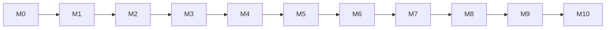

# Marcos de desenvolvimento — Zeny Hotel Manager (servidor)

> Criado em 2026-10-13 · fonte: [SPEC.md §9](../SPEC.md#9-fases-de-entrega) e [ARCHITECTURE.md §3](../ARCHITECTURE.md#3-módulos)

O desenvolvimento do servidor está dividido em **11 marcos**. Cada marco entrega um conjunto de módulos do monólito modular que funciona sozinho, com build e testes verdes. O marco seguinte só acrescenta código: não reabre o que o anterior entregou.

Cada marco tem seu próprio roadmap, com etapas pequenas e um gate final. Desde 2026-10-22, M5 a M10 seguem o formato da skill `development-roadmap`: um único "Prompt de execução" por roadmap, que executa um lote de etapas na branch `roadmap/<slug>`, cada etapa planejada pelo plugin superpowers e, desde 2026-10-27, executada pelas souls do Second Brain numa sessão iniciada com `claude --agent orquestrador-etapa` (M0 a M4, concluídos, ficaram no formato antigo, com um prompt por etapa). O gate de um marco é o critério de entrada do próximo.

## Mapa dos marcos

| Marco | Roadmap | Etapas | Fase da SPEC | Módulos (ARCHITECTURE §3) | Depende de | Resultado |
|---|---|---|---|---|---|---|
| M0 | [Fundação técnica](roadmap-m0-fundacao-tecnica.md) | 8 | 0 | projeto Gradle, `shared`, contrato OpenAPI, Docker, CI | — | Esqueleto que compila, testa, gera o contrato e sobe em `docker compose` |
| M1 | [Acesso, auditoria e configuração](roadmap-m1-acesso-configuracao.md) | 9 | 0 | `iam`, `audit`, `hotel`, `staff`, `files` | M0 | Login, roles com escopo e limites, step-up, auditoria, dados do hotel, data operacional, escala e anexos |
| M2 | [Plataforma operacional](roadmap-m2-plataforma-operacional.md) | 12 | 0 | `rooms`, `checklists`, `notifications`, tempo real (SSE) e sincronização offline em `shared` | M1 | UHs com status em tempo real, motor de checklists e base do app offline |
| M3 | [Hóspedes, contas e caixa](roadmap-m3-hospedes-contas.md) | 11 | 1 | `guests`, `payments` (registro manual), `billing` (sem contas a receber) | M2 | Cadastro de hóspedes com LGPD, contas imutáveis, caixa e pagamento manual |
| M4 | [Tarifas, disponibilidade e reservas](roadmap-m4-tarifas-reservas.md) | 13 | 1 | `rates`, `reservations` | M3 | Planos tarifários, disponibilidade sem overbooking, reservas, grupos e bloqueios |
| M5 | [Recepção, FNRH e impressão](roadmap-m5-recepcao-fnrh.md) | 12 | 1 | `frontdesk`, `fnrh`, `printing` | M4 | Check-in/out, walk-in, troca de UH, FNRH Digital e agente de impressão |
| M6 | [Operação diária e fechamento](roadmap-m6-operacao-fechamento.md) | 12 | 1 | `housekeeping`, `maintenance` (corretiva), `endofday`, `reporting` (operacional) | M5 | **Fim da Fase 1:** o hotel opera a hospedagem |
| M7 | [Pagamentos integrados e fiscal](roadmap-m7-pagamentos-fiscal.md) | 12 | 2 | `payments` (Pix, cartão, conciliação), `fiscal` | M6 | Pix e cartão integrados, caução, NFS-e e NFC-e |
| M8 | [Restaurante, distribuição e inauguração](roadmap-m8-restaurante-distribuicao.md) | 13 | 2 | `pos`, `distribution`, implantação e backup | M7 | **Fim da Fase 2:** pronto para inaugurar |
| M9 | [Suprimentos](roadmap-m9-suprimentos.md) | 14 | 3 | `inventory`, `linen`, ações de checklist, fichas técnicas em `pos` | M8 | Custos e insumos sob controle |
| M10 | [Comercial e gestão](roadmap-m10-comercial-gestao.md) | 14 | 4 | `events`, contas a receber, manutenção preventiva, `reporting` gerencial, retenção LGPD | M9 | Gestão completa |

A ordem segue as camadas de módulos da ARCHITECTURE §3.2: um marco só usa módulos de marcos anteriores. A sequência é linear por segurança, mas há folgas possíveis se houver mais de uma pessoa no projeto:

- M3 não usa nada de M2 além do que M1 entrega, então pode começar logo após M1, desde que cada um rode em seu próprio worktree.
- Em M7 e M8, os adaptadores de fornecedores ficam bloqueados até a SPEC Q-05 ser decidida, mas as portas neutras e os demais trabalhos podem avançar.

Duas exceções controladas à regra "um marco por vez", registradas nos próprios roadmaps:

- **M5 → M6:** o gate do M5 não espera a homologação da FNRH (M5 E09, bloqueada pela Q-12). Ela fica como pendência obrigatória antes da operação real.
- **M7 → M8:** as etapas não bloqueadas do M8 podem começar com M7 E01–E08 concluídas, usando os adaptadores falsos de pagamento e fiscal. O gate do M8 (inauguração) continua exigindo o gate do M7, ou seja, os fornecedores reais.

## Regras para todos os marcos

1. **Um marco por vez.** Comece o marco N só quando o gate do marco N−1 estiver `#concluida`.
2. **Sincronize antes de começar.** Os roadmaps de M1 em diante foram escritos antes do código existir. Antes de executar a primeira etapa de um marco, peça ao Claude Code para atualizar aquele roadmap com a skill `development-roadmap`, conferindo caminhos, comandos e convenções reais registrados nos handoffs dos marcos anteriores.
3. **Comandos oficiais** de build, teste e lint são definidos na etapa E01 de M0 e registrados no `CLAUDE.md` e no `README.md` da raiz. Os roadmaps seguintes mandam lê-los lá. Desde 2026-10-22 (M5, depois da E03) o resto da referência técnica que os roadmaps citam como "seção do `CLAUDE.md`" vive no Second Brain (nota de projeto `ZenyHotelManager` e notas de tema, carregadas pelo hook do `.claude/settings.json`, que roda o `load-brain.py` da skill `development-roadmap`), e o orquestrador de cada lote publica, no fechamento de cada etapa que muda algo descrito no brain, a captura `ZenyHotelManager - atualização <slug> Eyy` no `00 Inbox/` do brain (M5 a M10 já trazem isso no protocolo; "atualizar o `CLAUDE.md`" num handoff antigo quer dizer essa captura).
4. **Integração fica com você.** A execução de um roadmap commita por tarefa só na branch `roadmap/<slug>` (o superpowers); nenhuma sessão faz merge, PR, push ou deploy sem a sua decisão, tomada no fim de cada lote com `superpowers:finishing-a-development-branch` (decisão do usuário, 2026-10-22). Fora dos roadmaps, commit só a pedido.
5. **Questões em aberto** da SPEC §10 que travam etapas aparecem como `#bloqueada` no roadmap do marco afetado, com a ação de desbloqueio.

## Questões em aberto que travam marcos

| Questão (SPEC §10) | Marco afetado | Decidir até |
|---|---|---|
| Q-12 Cadastur e credencial da FNRH | M5 (homologação da FNRH) | início de M5 |
| Q-05 Fornecedores: PSP Pix, adquirente (TEF ou Smart POS), middleware fiscal | M7 | início de M7 |
| Q-02, Q-03, Q-04 Regime tributário, município e regras fiscais de A&B | M7 | início de M7 |
| Q-05 Channel manager | M8 | início de M8 |
| Q-06 Servidor na nuvem ou no hotel | M8 (implantação e backup) | início de M8 |
| Exportação contábil (RF-REL-08, formato a definir com o contador) | M10 E12 e, por consequência, o gate da v1 | início de M10 |
| Q-01 Financeiro administrativo | fora da v1 | — |

## Divergências entre SPEC e ARCHITECTURE (resolvidas em 2026-10-13)

O grafo de dependências da ARCHITECTURE §3.1 não cobria alguns fluxos da SPEC §8.3 e da própria ARCHITECTURE. Numa entrevista em 2026-10-13, o usuário decidiu:

1. **Regra por camadas.** Um módulo pode depender de qualquer módulo de camada inferior (ARCHITECTURE §3.2) e de qualquer módulo da Plataforma, desde que o grafo continue acíclico. Uma aresta nova assim não precisa de aprovação: basta acrescentá-la à tabela §3.1 na mesma mudança. `notifications` e `printing` nunca escutam eventos de módulos de negócio: quem gera o aviso ou é dono do documento chama esses módulos.
2. **Itens de empréstimo** (RF-REC-09) ficam no `frontdesk`.
3. **Documentos impressos:** o módulo dono monta os dados e chama `printing`.
4. **Comanda fechada (`TabClosed`):** um listener do próprio `pos` chama `fiscal` e `inventory`.

| Fluxo | Solução adotada | Onde |
|---|---|---|
| Rotinas de checklist após `BusinessDateAdvanced` | aresta `checklists → hotel` | M2 E07 |
| Alerta de estoque mínimo | aresta `inventory → notifications` | M9 E03 |
| XMLs fiscais em `files` | aresta `fiscal → files` | M7 |
| PDFs de proposta e BEO | aresta `events → printing` | M10 E05 |
| Ficha, extrato e confirmação | arestas `frontdesk`, `billing` e `reservations → printing` | M5 E11 |
| Aviso de pendência e PDFs do fechamento | arestas `endofday → notifications`, `reporting → printing` e `reporting → files` | M6 |
| Logotipo do hotel e cabeçalho dos documentos | arestas `hotel → files` e `printing → hotel` | M1, M5 |
| Alertas de falha de integração e rejeição fiscal | arestas `fnrh`, `payments`, `fiscal` e `distribution → notifications` | M5, M7, M8 |
| NFC-e e baixa por ficha técnica | listener de `TabClosed` em `pos` | M8 E04, M9 E12 |
| Itens de empréstimo | no `frontdesk`, sem porta | M9 E11 |

A ARCHITECTURE §3.1 e a SPEC §8.3 já foram atualizadas com essas decisões.

## Histórico de revisões

- 2026-10-13 — marcos definidos e roadmaps criados.
- 2026-10-13 — divergências entre SPEC e ARCHITECTURE resolvidas por entrevista (regra por camadas, empréstimos no `frontdesk`, documentos dono + `printing`, `TabClosed` tratado pelo próprio `pos`).
- 2026-10-14 — **M0 (Fundação técnica) concluído**: gate E08 conferido numa cópia limpa (build oficial com 178 testes, contrato, `docker compose` com readiness `UP`) e primeira execução da CI no GitHub verde (run `38502250745`, commit `6e9bd9c`). Próximo passo: sincronizar o roadmap do M1 com o código antes da primeira etapa.
- 2026-10-15 — **M1 (Acesso, auditoria e configuração) concluído**: gate E09 conferido numa cópia limpa do snapshot `baa49db` (Gradle sem cache, `./gradlew clean build` com 411 testes e 0 falhas, `test`, `lint`, `checkOpenApi`, oasdiff sem breaking change) e roteiro ponta a ponta com `curl` contra o `docker compose` (login do administrador inicial, roles e usuários, step-up, auditoria, configuração do hotel, escala do dia e anexos), com readiness `UP`. Módulos entregues: `iam`, `audit`, `hotel`, `staff` e `files`. A 1ª verificação achou o login em claro nos logs numa violação de unicidade, corrigido como ajuste da E03 (sem o DETAIL do PostgreSQL na aplicação e no `db`). Verificação independente APROVADA (2ª rodada); revisão humana feita em 2026-10-15, com quatro correções antes do commit: o proxy só repassa ao MinIO URLs pré-assinadas de objeto e o `.env.example` deixa as senhas do MinIO vazias (D1), a máscara da trilha reconhece o token `t1:` (D2), o boot recusa limites do multipart menores que o maior anexo aceito (D3) e ajustes de documentação (D4). Commits separados das etapas E08 (`fe4e91f`) e E09 (`372701d`), e a CI no GitHub verde (run `38783591046`, commit `372701d`). Próximo passo: sincronizar o roadmap do M2 com o código antes da primeira etapa.
- 2026-10-16 — **M2 (Plataforma operacional) concluído**: gate E10 conferido numa cópia limpa do snapshot `a7f2ab4` (e, pelo verificador independente, APROVADO, numa cópia limpa de `5463f5a`, com os ajustes do gate) (Gradle sem cache, `./gradlew clean build` com 638 testes em 81 classes e 0 falhas, `clean test`, `lint`, `checkOpenApi`, oasdiff sem breaking change contra `3b2d019` e contra o gate do M1, `372701d`) e roteiro ponta a ponta com `curl` contra um `docker compose` isolado, pelo proxy (cadastro de tipo, UH e área; SSE em `rooms` e `notifications` com o evento em menos de 0,1 s e a reconexão por `Last-Event-ID`; status com `If-Match`; OOO com aprovação de superior; foto com `clientFileId` enviada duas vezes e reencodada sem EXIF/GPS; checklist concluído offline sincronizado duas vezes, uma execução; download incremental com *tombstone*; relatórios; painel, preferências e dispositivo de push), com readiness `UP`. Módulos entregues: `rooms`, `checklists` e `notifications`, e o tempo real, a sincronização offline e o ciclo do outbox em `shared`. Sem caminho no compose (evidência nos testes): disparo de notificação (nenhum endpoint de produção chama `notify`), OOO recusado em UH ocupada (a ocupação vem do `frontdesk`, M5), publicações de `OutOfOrderChanged` e `ChecklistCompleted` (sem listener de produção até o M4/M6), rotinas (a data só avança no M6) e expurgos; o usuário aceitou essa evidência e pediu a notificação de ponta a ponta no gate do primeiro marco com disparo real. Ajustes do gate, decididos pelo usuário: uma só entrada da execução na trilha na conclusão com respostas (offline e API pública; ajuste da E07) e `for: 5m` no alerta de publicações abandonadas (ajuste da E12). Revisão humana e commit em 2026-10-16, com commits separados das etapas E08 (`5ab91f9`), E09 (`15b7ec7`) e E10 (`8d163b2`), e a CI no GitHub verde (run `38954633425`, commit `8d163b2`). Próximo passo: sincronizar o roadmap do M3 com o código antes da primeira etapa.
- 2026-10-20 — **M3 (Hóspedes, contas e caixa) concluído** (verificação independente APROVADO e revisão humana aceita pelo usuário em 2026-10-20; a CI do commit fica registrada no pré-requisito do roadmap do M4): gate E11 conferido numa cópia limpa do estado `1c53f27` (`git archive`, Gradle baixado do zero num `GRADLE_USER_HOME` novo, `--no-daemon --no-build-cache`): `./gradlew clean build` verde, `clean test` com 863 testes em 114 classes e 0 falhas (inclui o teste ponta a ponta do marco, `MilestoneM3EndToEndTest`), `lint` e `checkOpenApi` verdes, oasdiff sem breaking change contra o gate do M2 (`8d163b2`); a primeira rodada do `clean build` teve uma falha intermitente de teste (`GuestPrivacyApiTest`: passaporte de teste sorteado sem dígito, ~0,1% por perfil criado), corrigida no gate, só nos testes, por decisão do usuário. Roteiro ponta a ponta com `curl` num `docker compose` isolado (`prod`, pelo proxy, readiness `UP`, 185 conferências sem falha): modelos de role Recepcionista e Gerente; empresa e hóspede com CPF e dados sensíveis da FNRH (mascarados, cifrados, achados pelo índice cego, revelados com a trilha); mesclagem de duplicados; contas com pagador empresa, roteamento das diárias, taxa de serviço de 10% separada; recebimento sem turno recusado; turno cego; estorno, reembolso, reabertura, exportação e anonimização com aprovação de superior; caução capturada e liberada; encerramento só com saldo zero e sem caução; extrato `INTERNAL` e `GUEST`; **a notificação de diferença de caixa no painel e no tópico SSE `notifications` do Gerente (e do administrador), em ~0,1 s, e não no da operadora** (H14); o banco recusando `UPDATE`/`DELETE`/`TRUNCATE` nas tabelas *append-only* e as seis views `report_*` só com `SELECT`; `PaymentSucceeded` concluído pelo listener do `billing`; logs do `prod` sem documento, dado sensível, nome, senha, PIN nem token. Módulos entregues: `guests`, `payments` (registro manual) e `billing` (sem contas a receber). Próximo passo: sincronizar o roadmap do M4 com o código antes da primeira etapa.
- 2026-10-22 — **M4 (Tarifas, disponibilidade e reservas) concluído**: gate E13 aprovado pelo verificador independente (cópia limpa do snapshot `b7fd7d0` e compose isolado próprio, 187 conferências, 0 falhas) e revisão humana delegada ao orquestrador pelo usuário (quatro decisões pela opção recomendada); evidência do executor: gate E13 conferido numa cópia limpa do estado `f163147` (`git archive`, Gradle baixado do zero num `GRADLE_USER_HOME` novo, `--no-daemon --no-build-cache`): `./gradlew clean build` verde, `clean test` duas vezes com 1163 testes em 143 classes e 0 falhas (inclui o teste ponta a ponta do marco, `MilestoneM4EndToEndTest`, com 8 reservas simultâneas pela última UH e o pico de 8 em andamento), `lint` e `checkOpenApi` verdes, oasdiff sem breaking change contra o gate do M3 (`013ed01`), e roteiro ponta a ponta com `curl` contra um `docker compose` isolado, pelo proxy, com 187 conferências e 0 falhas (modelos de role Gerente e Recepcionista; cotação com plano derivado e restrição; reserva agrupadora com desconto aprovado; tarifa publicada alterada com aprovação sem mudar o preço congelado; alocação com a sobreposição recusada pelo banco; OOO refletido na disponibilidade e na marca de realocação pelos listeners de `OutOfOrderChanged`, com o aviso no painel; extensão da estadia; bloqueio com pick-up; multa de cancelamento na conta; reativação aprovada; pré-reserva vencida cancelada pelo job; mesclagem do titular repontando reservas e bloqueio pelo listener de `GuestsMerged`; anonimização recusada pela estadia ativa; views só com `SELECT`; logs sem dado de hóspede nem segredo). Módulos entregues: `rates` e `reservations`. Próximo passo: commit, CI e sincronizar o roadmap do M5 com o código antes da primeira etapa.
